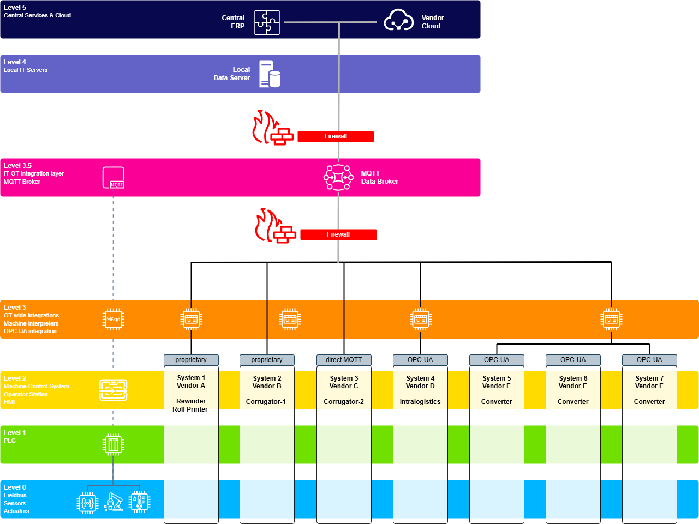

# COSI — Corrugated Standard Interface

**Version:** 1.0 · **Status:** Prepublication — package approved · **Publication date:** 2026-11-01

Open industry standard for machine data exchange in corrugated cardboard manufacturing. Defines MQTT message schemas and protocols for performance, setup, maintenance, quality data and optional OT Last Will notifications across corrugators and converting equipment.

All messages share a common JSON envelope (`messageID`, `assetClass`, `schemaId`, `messageType`, `machineId`, `timestamp`, `status`, conditional `correlationID` and `connectionId`) and carry an asset-class-specific `payload` validated against the corresponding JSON Schema.

---

## Documentation

| Document | Description |
|----------|-------------|
| [Technical Guide](docs/technical-guide.md) | Full specification: architecture, use cases, KPIs, security requirements |
| [Glossary](docs/glossary.md) | Standard definitions for all domain terms |
| [Corrugated Fault Codes](docs/corrugated-faults.md) | Closed set of 40 three-letter fault codes for corrugated equipment, adapted from ISO 14224:2016, Annex B |
| [Naming Conventions](docs/naming-conventions.md) | JSON field naming rules — case, language, abbreviations, `uom`, enums |
| [Message Properties](docs/message-properties.md) | Common envelope fields, allowed values, and timestamp format |
| [Changelog](CHANGELOG.md) | Authoritative record of what each version contains and what changed |

---

## Release PDFs

The six PDF volumes are Technical Guide, Glossary, Naming Conventions, Message
Properties, Corrugated Faults, and Schemas and Samples (generated from the JSON
schemas and examples).

Each release includes six finished PDF documents committed under `docs/pdf/<version>/`
(`docs/pdf/1.0/` for v1.0). The dated PDFs are produced and reviewed using the separate
documentation creator, then included in the release artifacts. Only PDF files belong in these
version folders; build sources, logs and intermediate output stay with the creator.

To assemble the PDF release artifact after the six reviewed files are present:

```sh
npm run package:pdfs -- --version 1.0 --output-dir tmp/release
```

This produces `cosi-1.0-pdfs.zip`, preserving the filenames under `docs/pdf/1.0/` and adding
`SHA256SUMS` at the archive root. Python 3.10+ is required. The command checks the file count,
PDF header/end markers and absence of other files; it neither compiles nor publishes PDFs.
Review must confirm that the six files represent the six documents and match the release sources.

For a packaging test, put only the six draft PDFs in a temporary folder and add
`--test-pdf-dir tmp/draft-pdfs`. Test archives always have `-TEST` in their name and contain a
`TEST-ONLY.txt` notice. Drafts are not copied into `docs/pdf/1.0/`. Existing output archives
are never overwritten. This PDF bundle is separate from the repository/source distribution.

---

## Validate schemas and examples

With Node.js 22 or newer and npm installed, run from a fresh checkout:

```sh
npm ci --ignore-scripts
npm run validate
```

The committed lockfile fixes the dependency versions. Validation compiles every schema as
published and checks every JSON example against both the envelope and its payload schema.
Invalid JSON, invalid schemas, unresolved references, missing inputs or invalid messages return
a nonzero exit status. References are not rewritten, and file counts are discovered rather
than fixed in the validator. No private assistant tools are needed.

To check selected message files or run the validator's regression tests:

```sh
npm run validate -- examples/lastwill/lastwill.json
npm test
```

For the repository consistency audit, also install Python 3.10 or newer and run:

```sh
npm run audit
```

The audit includes schema/example validation, public Markdown links and fragments,
ADR/register references, exclusion of private review material and document version labels.
It works without private assistant files or Git metadata. Historical meeting slots and archived
task counts do not determine current completion. Regression tests (`npm test`) also require Python.

The `Validate COSI` GitHub Actions workflow (`.github/workflows/validate.yml`) runs the same
audit and regression tests on pushes and pull requests, with a manual-run option. It installs
locked dependencies and uses Node.js 22 and Python 3.12 on Ubuntu. Its check is named
`Repository validation`; requiring that check before merging is a separate repository setting.

These checks do not establish semantic agreement with every decision, PDF layout, live MQTT
behavior or release approval. PDF creation and final package review remain separate steps.

---

## Schemas

| Schema | Asset class | Status |
|--------|-------------|--------|
| [envelope.schema.json](schemas/envelope.schema.json) | All | Approved |
| [common-types.schema.json](schemas/common-types.schema.json) | All (shared definitions) | Approved |
| [performance.schema.json](schemas/performance.schema.json) | `performance` | Approved |
| [setup-corrugator.schema.json](schemas/setup-corrugator.schema.json) | `setup-corrugator` | Approved |
| [setup-converting.schema.json](schemas/setup-converting.schema.json) | `setup-converting` | Approved |
| [lastwill.schema.json](schemas/lastwill.schema.json) | `lastwill` | Approved |
| [setup-response.schema.json](schemas/setup-response.schema.json) | `setup-response` | Approved |
| [maintenance-document.schema.json](schemas/maintenance-document.schema.json) | `maintenance-document` | Approved |
| [maintenance-measurement.schema.json](schemas/maintenance-measurement.schema.json) | `maintenance-measurement` | Approved |
| [quality.schema.json](schemas/quality.schema.json) | `quality` | Approved |

---

André Seifert approved the aligned v1.0 package on 16 October 2026, including all schemas above.
The six final PDFs will be supplied later; publication remains scheduled for 1 November 2026.
There are ten normative schema documents: envelope, shared definitions and eight payloads.

## Examples

Nine complete example messages validate against the envelope and their payload schema. Optional fields need not all be populated. The examples illustrate message bodies; the guide defines topics and MQTT settings.

| Example | Asset class | Message type | Machine | Status |
|---------|-------------|--------------|---------|--------|
| [performance/performance.json](examples/performance/performance.json) | `performance` | `hbt` | Corrugator | `run` |
| [setup/setup-corrugator.json](examples/setup/setup-corrugator.json) | `setup-corrugator` | `cos` | Corrugator | `setup` |
| [setup/setup-converting.json](examples/setup/setup-converting.json) | `setup-converting` | `cos` | Converting | `setup` |
| [lastwill/lastwill.json](examples/lastwill/lastwill.json) | `lastwill` | `cos` | Corrugator | `lastwill` |
| [setup-response/setup-response.json](examples/setup-response/setup-response.json) | `setup-response` | `cos` | Corrugator/Converting | `setup` |
| [setup-response/setup-response-error.json](examples/setup-response/setup-response-error.json) | `setup-response` | `cos` | Corrugator/Converting | `setup` |
| [maintenance/maintenance-document.json](examples/maintenance/maintenance-document.json) | `maintenance-document` | `onetime` | Corrugator | `maintenance` |
| [maintenance/maintenance-measurement.json](examples/maintenance/maintenance-measurement.json) | `maintenance-measurement` | `cos` | Corrugator | `fault` |
| [quality/quality.json](examples/quality/quality.json) | `quality` | `cos` | Converting | `run` |

---

The two setup-response examples illustrate **alternative outcomes** for the corrugator setup
example, not two successive responses to one processed request. Their correlationID points to
that setup message; the error pointers resolve against its full message body.

## Diagrams



| File | Description |
|------|-------------|
| [COSI_Architecture_Diagram_Bus.drawio](diagrams/COSI_Architecture_Diagram_Bus.drawio) | System architecture — MQTT bus, machine layers, IT/OT integration (editable source) |

---

## Quick Reference

**Message types:** `hbt` (heartbeat, periodic) · `cos` (change-of-status, event-driven) · `onetime` (static reference data)

**Asset classes:** `performance` · `setup-corrugator` · `setup-converting` · `setup-response` · `maintenance-document` · `maintenance-measurement` · `quality` · `lastwill`

**Ordinary machine status values:** `unknown` · `stop` · `run` · `fault` · `setup` · `maintenance` · `offline`. The dedicated Last Will uses `lastwill`.

**Failure severity:** `info` · `warning` · `critical`

**Check result:** `OK` · `NOK`

**Transport:** MQTT 3.1.1+, TLS on port 8883, QoS 1 recommended (required for Will), JSON/UTF-8 payload.

**Topics:** `cosi/<site>/<machine>/<assetClass>/<send|receive>`; direction is from the machine's perspective. No topic version segment; `schemaId` carries the full payload identifier and version.

**Scope:** MQTT carries IT/OT crossings. Horizontal exchanges within IT or OT may use other protocols. ERP/MES sends setup; machines respond and return operator-changed settings plus observations. Consumers need not publish equipment telemetry.

Queue management (`queue`, `queue-delete`) is excluded from v1.0; its draft artifacts are preserved in [ideas/queue-management](ideas/queue-management/README.md).

---

[Imprint and Privacy Notice (Impressum / Datenschutz)](IMPRINT-PRIVACY.md)
